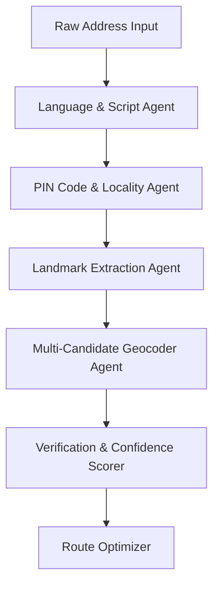

# Multi-Agent Pipeline Architecture

The Pata AI resolution engine utilizes an asynchronous multi-agent architecture designed specifically for the Indian address landscape.

## Pipeline Lifecycle

## Agent Responsibilities

1. **Language Agent**: Detects mixed Hinglish/regional script and transcribes into normalized English address tokens.
2. **PIN Code Agent**: Parses 6-digit postal code and verifies state/district centroids using the national postal directory.
3. **Landmark Agent**: Identifies proximity prepositions (`near`, `opp`, `beside`) and cross-references local OSM points of interest.
4. **Ranking Agent**: Computes spatial confidence weights and filters outliers outside geographical bounding polygons.
5. **Route Optimizer**: Formulates optimal dispatch sequence using greedy TSP heuristics for last-mile delivery riders.
